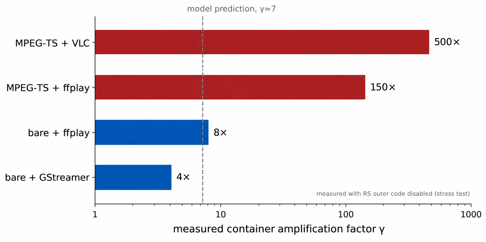
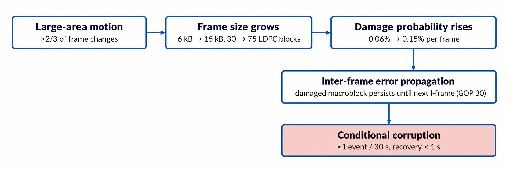
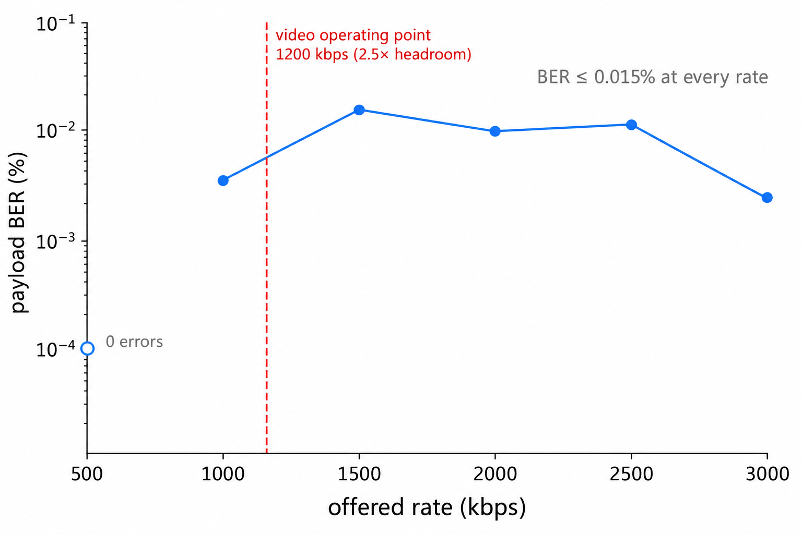

# 面向开源 OFDM 通感一体化平台的实时视频传输跨层实验研究：最轻量充分纠错原则

> **中文版说明**：本文件为英文稿 `manuscript_v1.md` 的全文中译，供两用：(a) 改投中文期刊（科技核心/中文核心）时的底稿；(b) 直接改写为学位论文第 3–6 章的正文素材。图表沿用英文版（图内文字为英文，投中文期刊如需中文图内文字可再重绘）。参考文献保留原文。

**作者**：[待补]
**单位**：[待补]

---

## 摘要

通感一体化（Integrated Sensing and Communication, ISAC）系统在共享的 OFDM 波形上同时传输雷达感知数据与用户数据，而实时视频是此类链路所能承载的最苛刻业务之一：它要求持续的吞吐量、有界的时延，以及对物理层纠错后残留误码的容忍能力。本文报道了在开源实时 OFDM-ISAC 平台 OpenISAC 上、经 USRP N320 与 B210 软件无线电设备构成的空口链路，开展实时 H.264 视频传输跨层实验研究的结果。通过对协议栈各层的受控测量，我们发现交付视频质量的主导因素并非内码强度，而是两个通常被视为固定工程选择的因素：外码冗余量与应用层传输栈。其一，四种 Reed-Solomon 外码的 Pareto 扫描表明，链路同步完成后所有配置的稳态失败均为零，意味着最轻量的 RS(255,223)（14.3% 冗余）已经足够，且相较原部署的 RS(255,191) 恢复了 8.4% 的有效载荷吞吐；实测 LDPC 残差错率低于 5×10⁻¹⁰。其二，我们对 MPEG-TS 容器封装的误码脆弱性进行了建模与测量：仅由头部暴露预测的放大系数为 7 倍，而在三种解码器上实测为 4–500 倍；以裸 H.264 Annex B 流替代 MPEG-TS 并选用容错解码器后，基于容器的播放所出现的持续性解码停顿得以消除。其三，将队列深度从 32 削减至 4–8 帧、以非阻塞丢弃替代阻塞写入，消除了正反馈时延累积环路，使端到端时延钉在 250 ms、稳态抖动仅 0.5 ms，其中约 80% 来自视频解码器而非 ISAC 链路。上述结果支持一种"最轻量充分纠错"（least-sufficient protection）设计原则：在强编码 ISAC 链路上，保护应加在最稀缺的容器与解码器层，而在残留误码本已稀疏处保持最小。边界条件：单条室内视距链路、QPSK 调制、640×480@20 fps H.264、单一接收平台。

**关键词**：通感一体化；OFDM；实时视频传输；Reed-Solomon 码；LDPC 码；MPEG 传输流；跨层设计；软件定义无线电

---

## 1. 引言

第六代移动网络（6G）预计将原生支持通感一体化：同一波形、硬件与频谱同时服务于数据传输与环境感知 [1]–[4]。由于 ISAC 链路由宽带 OFDM 传输、大规模天线阵列与高速数字基带处理构成——与现代雷达同源——单一链路即可在交付用户数据的同时完成对周边环境的距离/多普勒估计 [5]。实验型 ISAC 平台因此成为社区关注焦点，OpenISAC 等开源平台使得以适度硬件开展完整物理层空口实验成为可能 [6], [7]。

在此类链路可承载的业务中，实时视频是极限压力测试。它要求持续吞吐、有界且不累积的时延，以及最具特色的一点：对*残留误码*的容忍——即在物理层前向纠错（FEC）后仍然存活的比特错误。残留误码对文件传输无害（重传即可修复），但对 H.264/AVC [8] 这类帧间预测编码具有结构性破坏：单个受损宏块会沿预测环传播直至下一次帧内刷新，损毁长达一个图像组（GOP）的帧。实时 ISAC 视频业务由此把强编码 OFDM 链路的误差统计特性与容器、解码器、缓冲层的设计决策耦合在一起——而现有 ISAC 实验研究恰恰没有审视这些决策，因为它们评估的是感知估计精度或链路级吞吐，而非连续媒体业务。

无线视频传输的已有工作分别研究了其中每一层。应用层的抗误码视频研究考察了 FEC、重传与跨层自适应 [9]–[11]；学习型联合信源信道编码则用学习式编解码器替换经典分离式栈的组成部分 [12]。信道编码研究长期使用 RS/LDPC 或 RS/卷积码级联架构，外码规模依据内码残差的模型确定 [10], [13]。缺失的是一个系统性的、基于实测的回答：在一条已经运行强 LDPC 内码的现代 ISAC 链路上，*视频质量究竟在哪一层被打破*——哪一层的选型主导交付质量，每一层实际需要多少保护。据我们所知，尚无实验工作在真实 ISAC 链路上量化 MPEG 传输流（MPEG-TS）容器 [14]——H.264 over IP 的默认封装——的误码放大行为，也比较主流解码器栈对同一物理层误码流的响应。

本文给出了这样一个回答。使用 OpenISAC 平台 [6]（N320 基站 + B210 用户设备，室内空口链路），我们为实时 H.264 视频业务的每一层加装测量仪表，并在每一层开展受控实验：

1. **外码冗余（第 4 节）**。对四种 RS(255,K) 外码（K = 223, 207, 191, 179）的 Pareto 扫描表明：链路一旦同步，*所有*配置均交付零稳态块失败。LDPC(1008,504) 内码的残差错率低于 5×10⁻¹⁰，因此外码仅充当同步阶段的瞬态保护，最轻配置即最优：RS(255,223) 相较部署的 RS(255,191) 恢复 8.4% 的有效载荷吞吐，而可靠性不可区分。
2. **容器与解码器选型（第 5 节）**。我们推导的包失败模型表明，MPEG-TS 封装仅由头部暴露就将裸 H.264 字节流的有效失败概率放大 γ ≈ 7 倍；在禁用外码的极限压力测试下，三种解码器栈实测 γ = 4–500 倍。以裸 H.264 Annex B 流替换 MPEG-TS 并选用容错解码器后，同一物理误码流下基于容器的播放所出现的持续停顿被消除。
3. **缓冲与时延（第 5、7 节）**。将队列深度从 32 降至 4–8 帧、以非阻塞丢弃替换阻塞入队，消除了正反馈时延环路；端到端时延钉在 250 ms、稳态抖动 0.5 ms（五分钟），分解显示其中 ≈80% 属于 H.264 解码器而非 ISAC 链路。
4. **调制、编码与波形参数（第 6 节）**。16QAM 在 B210 接收端是计算受限而非信道受限；编码码率与 GOP 的扫描界定了误码传播暴露；循环前缀缩减实验定位了室内多径时延扩展，即保护间隔必须覆盖的下限。

本文其余部分组织如下：第 2 节讨论相关工作；第 3 节描述系统；第 4–7 节给出实验结果；第 8 节将结果提炼为一条设计原则——*最轻量充分纠错*——并陈述局限；第 9 节总结全文。

## 2. 相关工作

**ISAC 平台与空口实验。** OFDM 融合通信与雷达感知的处理框架可追溯至 Sturm 与 Wiesbeck 的波形融合分析 [5]；此后双功能波形与系统设计的理论文献迅速丰富 [2]–[4]。然而实验验证长期稀缺，因为实时 ISAC 需要完整的收发链路空口运行。近年开源平台填补了这一空白：Brunner 等 [7] 实现了带空口同步的双站 OFDM ISAC；OpenISAC [6] 提供了支持单/双站感知、YAML 运行时配置与主流 USRP 硬件的开源实时 OFDM-ISAC 平台。这些平台证明了感知估计与链路级吞吐可以在空口测量，但未回答*连续媒体业务*在此类链路上的行为：其评估对象是感知精度与物理层性能，容器封装、解码器行为与缓冲规模仍是不被审视的工程默认值。本文以该平台为给定条件，测量的正是这一被忽视的层。

**无线视频传输与跨层设计。** 大量文献研究无线网络上的抗误码视频，涵盖应用层 FEC、重传、不等保护与跨层速率自适应 [9]–[11]。这些研究普遍假设物理层给定（如既有蜂窝链路）或抽象为包删除信道，从而在应用层内优化。学习型联合信源信道编码（JSCC）[12] 端到端替换部分经典栈，但要求更换编解码器，难以部署在既有 H.264 生态上。上述路线均未涉及物理层本身可配置且已运行强 LDPC 码的场景——ISAC 原型平台正是这种场景，而其中有趣的问题恰恰是：更高各层还需要多少*额外*保护。

**级联编码与残留误码处理。** 依据内码残差规模确定外码强度是经典问题 [10], [13]，标准做法按建模的最坏情况确定外码。而在我们真实 QPSK 链路的实测中，建模的最坏情况远偏悲观：LDPC 残差稀疏到最轻的外码在稳态也从未触发纠错。我们的 RS Pareto 扫描把这种稀疏性量化为经验结论并转化为具体设计规则；同时，通过实验性禁用外码，暴露了交付视频质量在多大程度上由信道码*之上*的容器与解码器决定。

## 3. 系统描述

### 3.1 平台与视频管道拓扑

全部实验基于 OpenISAC 平台 [6]——一个 C++ 物理层运行于软件无线电上的开源实时 OFDM-ISAC 实现。基站（BS）使用 NI USRP N320（双通道、200 MHz FPGA、内置 GPSDO 驯服），经 SFP+ 10-Gigabit Ethernet 连接；用户设备（UE）使用 NI USRP B210（AD9361 前端、12-bit ADC、USB 3.0）。两端均使用对数周期天线（6–8 dBi，60–90° 波束宽度）。视频业务叠加在平台的 UDP 载荷接口之上：

```
摄像头 → H.264 编码器 → UDP :50000 → ISAC 调制器（N320）→ 空口 →
ISAC 解调器（B210）→ UDP :50001 → H.264 解码器 → 显示
```

感知链在同一波形上并发运行：发射信号副本馈入 BS 的感知处理路径，解调并均衡后的符号支持 UE 侧的双站感知重建。本文全部实验中，视频业务与感知功能在同一链路上同时运行。


**图 1 ｜ 系统拓扑。** OpenISAC 平台上的实时视频业务：摄像头 → H.264 编码 → ISAC 发射链（RS–LDPC 级联编码 + OFDM）→ 无线链路 → ISAC 接收链 → H.264 解码 → 显示。单站与双站感知在同一波形上并发运行。

### 3.2 OFDM 帧结构

表 1 列出固定的波形参数。帧长 2.304 ms（≈434 帧/秒）。直流子载波置零以避免本振泄漏；978 个子载波承载数据与导频。同步符号（符号索引 1）由根指数 u = 29 的 Zadoff–Chu 序列填充，其恒模零自相关特性给出平坦的频域幅度与尖锐的时域相关峰，用于帧同步。导频子载波承载已知的 ZC 参考符号，用于载波频偏（CFO）、采样频偏（SFO）与信道相位跟踪；在验证 LMMSE 估计器可从 8 导频无观测退化地重建完整 1024 子载波响应后，我们将导频密度从 16 降至 8 个均匀分布子载波（[29, 150, 270, 391, 571, 692, 812, 933]），每帧释放 792 个资源元素（+0.79% 吞吐）。

**表 1. OFDM 帧参数。**

| 参数 | 符号 | 取值 |
|---|---|---|
| FFT 点数 | N | 1024 |
| 循环前缀 | G | 128（12.5%，2.56 μs） |
| 每帧符号数 | M | 100 |
| 采样率 | F_s | 50 MHz |
| 子载波间隔 | Δf | 48.828 kHz |
| 帧时长 | T_f | 2.304 ms（≈434 帧/秒） |

### 3.3 级联信道编码链

发射链为

```
UDP 载荷 → RS(255,223) 外码 → LDPC(1008,504) 内码
→ 扰码 → 21×48 块交织 → QAM 映射 → OFDM 调制
```

**RS(255,K) 外码**工作于 GF(2⁸)，本原多项式 0x11D，每个 255 字节码字可纠 t = (255−K)/2 个字节错误，采用标准的伴随式 → Berlekamp–Massey → Chien/Forney 三步链；解码失败时回退为透传该块，成功/失败计数器暴露区间失败率。每个载荷前置 2 字节大端长度前缀，使解码端可恢复变长 UDP 数据报。**LDPC(1008,504) 内码**（码率 1/2）使用 AFF3CT 库 [15] 的 BP 水平分层归一化最小和解码器，6 次迭代，启用基于校验子的提前终止。扰码器为 LFSR，多项式 x⁸ + x⁷ + x³ + x² + 1，种子 0x5A；21×48 块交织器将 LDPC 解码突发分散到整个码字。

### 3.4 接收端处理与视频栈

接收端执行 LMMSE 信道估计（ZC 参考的 LS 估计、CP 长度时域 Wiener 滤波）、导频相位差加权线性回归的 CFO/SFO 联合估计、带相位斜率校正的迫零均衡，以及 Gray 编码方形 QAM 星座的最大对数 MAP 软解映射。预测性定时补偿器利用检测到的 CFO 预校正两台无线电时钟域之间的帧定时漂移。

在载荷接口之上，最终配置中的视频业务两端均使用 GStreamer：发射侧 `rtspsrc → h264parse → udpsink`，接收侧 `udpsrc → h264parse → avdec_h264`，承载裸 H.264 Annex B 基本流（第 5.2 节解释为何不用 MPEG-TS）。基线视频格式为 640×480@20 fps、1200 kbps、GOP 30，x264（ultrafast）编码；同时测试了 NVENC 硬件编码器（RTX 3050，preset p1），编码时延从 ≈10 ms 降至 <1 ms，接收侧无可见差异。

## 4. 外码冗余：Pareto 分析

### 4.1 动机：LDPC 之后的残留误码

有限迭代次数的 LDPC 解码器存在错误平层：即使在高信噪比下，码字仍偶以少量残留比特错误失败。对文件传输而言这些残留可由重传修复；对帧间视频而言则被放大为长达一个 GOP 的可见损伤。经典补救是在其上加一层按内码残差规模设定的字节向外部码 [10], [13]——但外码*需要多强*是一个经验问题，据我们所知尚未在真实强编码 ISAC 链路上以测量方式回答。为此我们扫描了冗余量跨越 3 倍范围的四种 RS(255,K) 配置（表 2）。

**表 2. 受试 RS 外码配置。**

| 配置 | K（数据字节） | 校验字节 | t（可纠错） | 冗余 |
|---|---|---|---|---|
| RS(255,223) | 223 | 32 | 16 | 14.3% |
| RS(255,207) | 207 | 48 | 24 | 23.2% |
| RS(255,191) | 191 | 64 | 32 | 33.5% |
| RS(255,179) | 179 | 76 | 38 | 42.5% |

### 4.2 实验设计

每种配置编译进两端无线电后，以固定模式载荷（1024 字节包，4 字节序号 + 0xA5 填充）按 500–4000 kbps 梯度、每档 10 秒注入，同时并发运行 640×480@20 fps H.264 流做主观质量评估。失败率在成功计数器超过 20,000 包（稳态）后读取。各配置间 QPSK 链路、中心频率与其余参数全部保持固定。

### 4.3 结果：全部配置稳态零失败

结果毫不含糊：**包括最轻配置在内的每一种配置，稳态下记录的解码失败均为零。**整个实验周期中唯一的失败事件发生在启动后的首个测量窗口（成功计数 < 1,000），即初始帧同步瞬态期，且在全部四种配置中均出现——说明其源于同步建立过程，而非残留信道错误超出某个特定的 t。瞬态之后，失败率随包数按 1/n 衰减，这是单次有界瞬态事件而非持续误码过程的统计特征。

整个周期累计解码超过 10⁶ 个 RS 码字而无一次稳态纠错事件，将室内信噪比条件下 LDPC 残差字节误码率上界约束在 1/(255×8×10⁶) ≈ 5×10⁻¹⁰ 以下。各配置的主观视频质量不可区分。

### 4.4 Pareto 选择与吞吐回收

稳态可靠性相等时，最轻的码占优。将部署配置从 RS(255,191)（33.5% 冗余）切换为 RS(255,223)（14.3%）使码率比提升 223/191 − 1 = 16.8%；计入 1024 字节载荷的 2 字节长度前缀后，有效载荷吞吐增益为 8.4%。后续实验全部采用 RS(255,223)。

由此得出两点。其一，在该链路上外码的功能是*瞬态保护*——吸收同步建立窗口——而非主动纠错器；其稳态纠错能力是闲置余量。其二，LDPC 残差的稀疏性意味着加在外码*之上*的任何保护，在稳态面对的实际上是一条干净的字节流——这正是第 5 节中容器与解码器级失败（在外码禁用时出现）在压力条件下主导视频质量的原因。

## 5. 应用层优化

### 5.1 队列规模与时延累积的消除

初始部署在管道四个位置（编码后缓冲、调制后循环缓冲、解调前帧队列、同步队列）使用默认深度 32 帧。在 434 帧/秒下每级队列贡献最高 ≈74 ms 的最坏情况排队时延，且总时延并非简单相加：当 H.264 解码器短暂停顿时，UDP 接收缓冲填满，解调器下游发送阻塞，LDPC 解码线程被反压，帧队列进一步加深——一个时延无界累积的正反馈环路。

我们采取结构性而非增量式处理：队列深度削减至维持连续处理的最小值（编码后 16、调制后 8、解调前 4、同步 8），并以溢出即丢弃的 `try_push` 语义替换全部阻塞入队。丢弃把无界的时延增长转换为有界且可见的损失——对实时业务这是正确的取舍。修改后，端到端时延——以秒表法测量（毫秒计时器同时被摄于摄像头前与接收显示画面中；30 fps 拍摄给出 ≈33 ms 分辨率）——在五分钟运行的稳态样本中钉在 **250.3 ± 0.5 ms**，无累积趋势（图 2；完整轨迹见第 7.1 节）。

### 5.2 容器脆弱性：γ 的建模与测量

H.264 over IP 通常封装于 MPEG 传输流 [14]。TS 为错误特性受控的广播信道设计，其重同步机制假设错误罕见且有界。我们将其在字节错误概率为 p 的链路上的行为建模如下。TS 包长 188 字节，其中关键字段——0x47 同步字节、PID 与连续性计数器、PES 起始码——占 m 个关键字节；任一关键字节的单比特错误都会导致整包被丢弃或连续性计数断裂。由于实际部署将 7 个 TS 包捆为一个 UDP 数据报（1316 字节），任一子包受损即摧毁整个包束的同步，每包束的有效关键字节数为 m ≈ 28。包束失败概率因此为 P_fail^TS ≈ 28p。相比之下，裸 H.264 Annex B 流在任意 4 字节起始码（0x00000001）上即可重同步，P_fail^raw ≈ 4p。容器由此把有效失败概率放大

$$\gamma_{model} = P_{fail}^{TS} / P_{fail}^{raw} \approx 7.$$

包丢失之外，TS 的同步*恢复*本身也是脆弱的。恢复过程可建模为吸收马尔可夫链：解析器逐字节跳过寻找 0x47，可能锁定载荷内的伪 0x47，连续性验证失败后重新进入搜索；只有连续读入一串有效包头（通常 3–5 个）才到达吸收态"锁定"。伪锁定循环期间解码器丢弃全部输入，可达数秒。这正是 VLC 观察到的 `TS discontinuity` 停顿的机制。

我们以经验方法测量*容器放大因子* γ = P_data_loss/p：在禁用 RS 外码的条件下运行各传输栈（一项把解调后字节错误率抬升至可测水平、而 LDPC 内码仍在运行的极限压力测试）：

**表 3. 实测容器放大因子（RS 外码禁用）。**

| 传输栈 | γ（实测） | 主导机制 |
|---|---|---|
| MPEG-TS + VLC（硬解路径） | ≈500× | 同步搜索滞留 + 缓冲死锁 |
| MPEG-TS + ffplay（软解） | ≈150× | 有界同步搜索，无死锁 |
| 裸 H.264 + ffplay | ≈8× | 偶发帧级连锁 |
| 裸 H.264 + GStreamer（`output-corrupt=true`） | ≈4× | 仅起始码风险；静默跳帧 |

在该压力测试下，MPEG-TS + VLC 的可用播放时间为 0%（持续冻结帧），MPEG-TS + ffplay ≈30%，裸 H.264 + GStreamer ≈95%，此时 TS 包原始失败率为 99.5%。重新启用外码后同样的次序保持（TS 栈报告的 `Packet corrupt` 事件远多于裸流的静默跳过），确认差异归因于容器与解码器而非物理误码流的变化（图 3）。实测放大（4–500 倍）从两侧包夹头部暴露预测（7 倍）：下限处，容错解码器修复了大部分暴露；上限处，解码器状态机将其进一步放大。

设计结论是：在偶发残留误码的 ISAC 链路上，**应以裸 H.264 Annex B 替代 MPEG-TS**，以手工处理流边界为代价换取 7 倍的模型化暴露削减——且解码器必须以容错性而非吞吐为选型标准。



**图 3 ｜ 容器放大因子 γ。** 模型预测（虚线，仅头部暴露）与 RS 禁用压力测试下四种传输栈的实测对比。MPEG-TS 栈（红）把有效失败概率放大到远超头部暴露预测；裸流栈（蓝）位于其下。

### 5.3 解码器选型

表 4 汇总三种受试解码器。VLC 将硬件优先的解码路径与 TS PCR 时钟参考耦合；连续性链断裂时死锁。ffplay（libavcodec，外部时钟）退化平缓但可见。GStreamer 的 `avdec_h264` 加 `output-corrupt=true` 随到随输出受损帧并在损伤时静默跳过，在裸流上给出最干净的恢复行为。我们采用 GStreamer + 裸 H.264 作为参考接收栈。

**表 4. 残留误码下的解码器行为。**

| 解码器 | 解码路径 | 时钟模型 | 误码响应 |
|---|---|---|---|
| ffplay（libavcodec） | 软件 | 外部时钟（`-sync ext`） | `Packet corrupt` → 错误隐藏 |
| VLC（VDPAU） | 硬件优先 | PCR 参考 | `TS discontinuity` → 死锁 |
| GStreamer（avdec_h264） | 软件 | 无 | `output-corrupt=true` → 输出/跳过 |

### 5.4 大面积运动下的条件性误码传播

即便在优化后的配置中，仍存在一种特定的失败模式：当画面中超过 ≈2/3 的区域在帧间发生变化时，H.264 帧大小从 ≈6,000 字节增长到 ≈15,000 字节，每帧 LDPC 块数从 ≈30 增至 ≈75。在单块残留失败概率 ≈0.002% 下，运动帧含至少一个受损块的联合概率为 ≈0.15%（静止帧为 0.06%）——而损伤一旦发生，错误隐藏恰恰失效，因为上一帧对应位置的像素已经移走。在 20 fps 下即 ≈0.03 次/秒：*仅在持续大面积运动下*约每 30 秒一次可见损伤，在一个 GOP 内（<1 s）恢复。这是帧间编码与信道随机性的结构性交互，而非系统缺陷；第 6.2 节量化编码码率如何界定其暴露（图 4）。



**图 4 ｜ 条件性花屏的因果链。** 大面积运动抬升帧大小与 LDPC 块数，提高每帧联合损伤概率；帧间预测随后将损伤传播至下一个 I 帧，产生 ≈每 30 秒一次、单个 GOP 内恢复的可见损伤。

## 6. 调制与参数研究

### 6.1 16QAM：计算受限的上限

QPSK → 16QAM 切换使理论吞吐翻倍（4.7 → 9.5 Mbps）。在 B210 接收端上切换失败——但并非信道失败。星座保持干净（16 个分辨良好的点），而 CPU 负载从 32% 升至 105%、每帧处理时间从 0.74 ms 升至 2.38 ms，帧队列溢出、链路中断。不对称性在软解映射器：QPSK 的 PAM-2 最大对数 MAP 每资源元素需两个 LLR 项，而 16QAM 的 PAM-4 需要四项外加绝对值与比较分支。在 2.304 ms 帧预算内，B210 的嵌入式处理器无法完成翻倍的计算量。因此 QPSK 是*该接收平台*的实际调制上限，且瓶颈是计算性的而非信息性的——这说明解锁高阶 QAM 需要接收机升级（第 8.3 节），而非波形变更。

### 6.2 视频编码参数扫描

固定 640×480@20 fps 扫描 H.264 码率（表 5）暴露了画质与误码传播暴露之间的权衡：更高码率 → 更大帧 → 每帧更多 LDPC 块 → 更高的联合损伤概率。1200 kbps（≈38 块/帧）被选为画质可接受且运动伪影频率最低的工作点；2500 kbps 使可见伪影率翻倍。GOP 30 界定了误码传播窗口。MJPEG（无帧间预测）作为替代方案测试：其损伤天然局部化（无传播），但同等分辨率下更大的帧抬高了每帧损伤频率，综合体验逊于 H.264。MJPEG 适用于时延极端敏感、可接受频繁但局部损伤的应用。

**表 5. 码率扫描（640×480@20 fps）。**

| 码率 (kbps) | ≈字节/帧 | ≈LDPC 块 | 画质 | 运动伪影 |
|---|---|---|---|---|
| 800 | 5,000 | 25 | 中等 | 低 |
| 1200 | 7,500 | 38 | 良好 | 低（选定） |
| 1800 | 11,250 | 56 | 良好+ | 中 |
| 2500 | 15,600 | 78 | 很好 | 高 |

### 6.3 循环前缀裕量：CP=64 的失败

将循环前缀减半（128 → 64 采样点；12.5% → 6.7% 开销）预示 +5.9% 吞吐。室内条件下它彻底失败：接收端进入 `No valid delay found` 循环并伴随 0.5 s 硬复位，报告的 CFO 从 7.4 kHz（≈2.3 ppm，合理）跳至 95 kHz（30.6 ppm，物理上不可实现）——这是 ISI 污染导频相位回归的数学假象，而非真实漂移。机制：CP=64（1.28 μs ≈ 384 m）时，墙壁与天花板的室内反射超出保护窗，ISI 污染 LMMSE 信道估计，延迟谱峰均比跌破 20× 检测门限，同步崩塌。尽管 BS–UE 距离仅 ≈5 m，室内环境的*有效*时延扩展要求 CP=128（2.56 μs ≈ 768 m）。该实验为本带宽的室内 ISAC 链路提供了循环前缀的实测下界——设定要求的是反射几何，而非链路距离。

## 7. 端到端性能

### 7.1 时延：测量与分解

在完整优化配置（QPSK、RS(255,223)、1200 kbps 裸 H.264、GStreamer、调优队列）下，五分钟秒表轨迹（表 6、图 2a）显示稳态时延 **250 ms ± 0.5 ms**（前四个样本），全程无累积趋势；后续样本偏离（266、233，随后 112/38 ms）发生在解码器内部缓冲管理复位参考帧池时——接收侧软件行为，而非链路效应。

**表 6. 端到端时延轨迹（五分钟）。**

| 时刻 (s) | 时延 (ms) | 条件 |
|---|---|---|
| 0 | 250 | 稳态 |
| 20 | 250 | 静止场景 |
| 40 | 251 | 挥手运动 |
| 74 | 250 | 静止 |
| 176 | 266 | 稳态 |
| 205 | 233 | 稳态 |
| 235 | 112 | 解码器缓冲复位 |
| 277 | 38 | 复位后瞬态 |


**图 2 ｜ 端到端时延。**（a）五分钟秒表轨迹；阴影窗口为稳态区间（250.3 ± 0.5 ms）；灰点为解码器侧缓冲复位（接收软件，非 ISAC 链路）。（b）时延分解：H.264 解码器与 GStreamer 管道贡献 ≈250 ms 总量中的 ≈80%。

分解将 250 ms 中的 ≈80% 归于 H.264 解码器与 GStreamer 管道（≈200 ms），编码（≈10 ms）、缓冲（合计 ≈27 ms）、OFDM 组帧（2.3 ms）、FEC 解码（≈5 ms）与本机 UDP（<5 ms）构成其余部分。ISAC 链路自身仅贡献 ≈3 ms——该平台上视频业务的时延上限是应用栈，进一步的时延削减必须指向解码器路径而非无线电。

### 7.2 吞吐与误码率

自动化速率扫描（1024 字节固定模式包，每点 10 秒）在 RS(255,223) 保护下测量载荷接口的字节级 BER（表 7）。直至 3000 kbps 的每一速率下 BER 均 ≤0.015%，且计得的"错误"字节中约 0.78% 是测试头部非填充字节，故有效载荷误码率全程接近于零。BER–速率关系非单调（1500 kbps 最差，3000 kbps 最佳），与管道占用度一致：最佳点上 `try_push` 丢弃的突发包最少。系统因此以 ≈2.5 倍余量承载 1200 kbps 视频流，吸收 I 帧尺寸尖峰。

**表 7. 有效载荷 BER 与供给速率（RS 启用）。**

| 速率 (kbps) | 接收 (KB) | 错误字节 | BER |
|---|---|---|---|
| 500 | 643 | 0 | 0% |
| 1000 | 1,435 | 53 | 0.0036% |
| 1500 | 2,229 | 349 | 0.0153% |
| 2000 | 3,021 | 307 | 0.0099% |
| 2500 | 3,693 | 410 | 0.0108% |
| 3000 | 4,487 | 117 | 0.0025% |



**图 5 ｜ RS(255,223) 保护下有效载荷 BER 与供给速率。** 直至 3000 kbps 的每一速率下 BER 保持 ≤0.015%（空心标记：500 kbps 零错误）且非单调，与管道占用度而非信道容量一致。虚线标记 1200 kbps 视频工作点，链路以 ≈2.5 倍余量承载。

作为参照，QPSK 波形的理论容量为 ≈38 Mbps（97,992 载荷 RE/帧 × 2 bit × 1/2 LDPC × 223/255 RS ÷ 2.304 ms）；实测 3–5 Mbps 的可用吞吐受限于 B210 的 USB 3.0 接收路径、缓冲丢弃策略、LDPC 填充浪费与帧定时填充——正是接收机升级可直接解决的缺口（图 5）。

## 8. 讨论

### 8.1 最轻量充分纠错原则

第 4–7 节的测量可以凝练为如下陈述。在承载帧间视频的强编码 ISAC 链路上：

- **容器之下**，保护已经过剩：LDPC 残差稀疏到（实测 BER < 5×10⁻¹⁰）外码在稳态从不触发，最轻外码以吞吐优势占优。
- **容器及其上**，保护是最稀缺的资源：默认容器选择把有效失败暴露放大 7 倍（模型）至 500 倍（配不宽容解码器实测），而默认解码器可把瞬态损伤转化为持续停顿。

由此得出的工程规则——*把保护加在最稀缺处，而在残留已稀疏处保持最小*——反转了强化信道码的常见直觉。它也自下而上得到验证：外码完全移除时，99.5% 的 TS 包失败、基于容器的播放不可用，而裸流栈保持 ≈95% 可用播放——压力条件下决定视频存活性的是容器/解码器层，而非外码。该原则的推论是总冗余轴上的*可靠性悬崖*：近零冗余在容器层灾难性失败，而 14.3% 的适度外码冗余即完全充分——有用的设计区间来得又早又廉价。

### 8.2 竞争性解释

视频质量差异的三种替代解释值得审视。*物理层差异*：被实验设计排除——容器/解码器对比在同一误码流、同一波形上运行，且外码重新启用后次序保持。*码率差异*：TS 流与裸流承载相同码率；失败模式（同步字节丢失、连续性计数断裂）是结构性的而非码率相关的。*解码器吞吐*：VLC 的失败是状态机死锁而非吞吐不足——它发生在静止场景，且相同硬件上 ffplay 未出现。

### 8.3 局限与边界条件

全部结果限定于：单条室内视距链路（≈5 m，对数周期天线）；QPSK 调制；单一接收平台（B210），其计算上限塑造了调制结论；640×480@20 fps H.264；单一 LDPC 配置（码率 1/2，6 次迭代）。γ 测量源自禁用外码的压力工况；虽然正常工况下次序保持，γ 的绝对值是工况相关的。时延测量采用秒表法（≈33 ms 分辨率），对 250 ms 目标足够，不支持更细的分解。硬件升级分析（14-bit ADC、160 MHz 带宽的 X310 接收机加 15–20 dBi 喇叭天线，预计 ≈20 dB SNR 增益、释放 16QAM/64QAM、双通道 AoA 感知）是基于部件规格的*推测*，并非测量。

## 9. 结论

在承载空口实时 H.264 视频的开源实时 OFDM-ISAC 平台上，交付视频质量由信道码之上决定：LDPC 内码残差稀疏到最轻的 RS 外码已经充分（较部署的重码恢复 8.4% 载荷吞吐、稳态零失败），而容器与解码器选择把同一物理误码流放大 4–500 倍。以裸 H.264 Annex B 替代 MPEG-TS、选用容错解码器、把队列收缩为非阻塞最小值，得到钉在 250 ms ± 0.5 ms 的端到端时延——其中无线电仅贡献 ≈3 ms——以及直至 3000 kbps 的零误码载荷交付和视频速率 2.5 倍的余量。这些结果支持 ISAC 媒体业务的最轻量充分纠错设计规则：外码按实测残差而非建模最坏情况定标，其余工程预算投向保护最稀缺的容器与解码器。未来工作包括链路 SNR 驱动的外码自适应切换、物理层辅助错误隐藏（把每子载波置信度传递给解码器）、同一波形上的微多普勒生命体征感知，以及第 8.3 节硬件升级推测的实测实现。

---

## 参考文献

（保留英文版文献列表 [1]–[22]，中文投稿按目标期刊格式重排；列表见 `manuscript_v1.md`。）

---

> **内部备注（不随稿提交）**：中文版约 11,000 字；图 1–5 与英文版共用（图内英文标注）。作为学位论文素材时：第 4 节 → 论文第 3 章，第 5 节 → 第 4 章，第 6–7 节 → 第 5–6 章，第 8 节展开后 → 第 7 章（硬件路线）。
