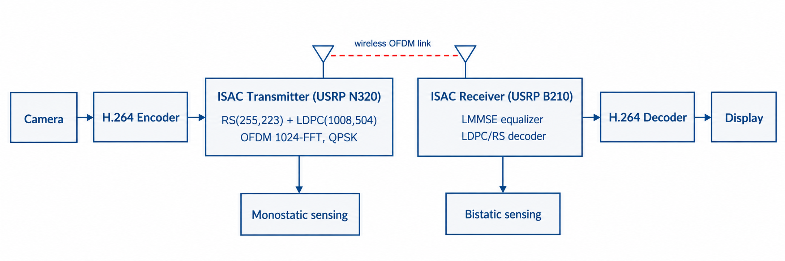
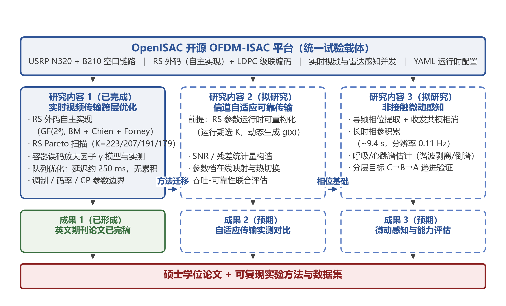
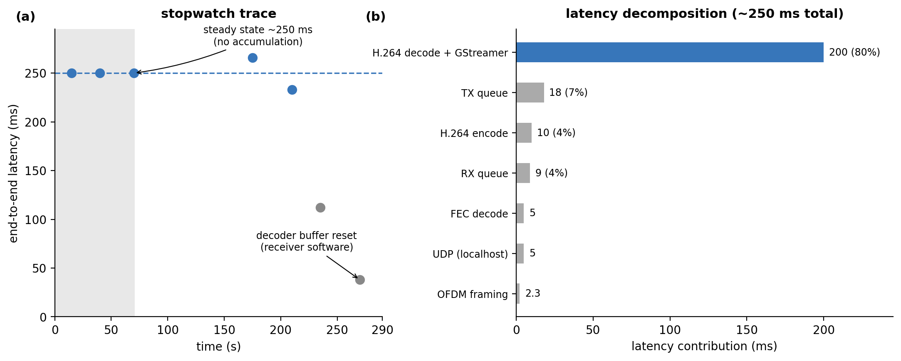

# 上海海事大学专业学位硕士学位论文开题报告

> **论文题目（拟）**：OFDM 通感一体化系统中实时视频传输与微动感知关键技术研究
> **姓名/学号/专业/领域/指导教师/实践导师/入学日期**：[待填]
> **培养类型**：全日制　**学位论文类别**：工程硕士·应用研究类
> **报告日期**：2026 年 10 月　**报告地点**：[待填]
>
> 注：本稿为提交导师审阅的工作稿；个人信息、成绩单、模板表格以学院下发版本为准。

---

## 一、课程学习、技术标准学习及校内实践（实验）情况、参加科研和学术活动情况

[本节由申请人按实际填写，建议包含：]

- **课程学习**：[培养方案课程成绩单要点，建议突出与课题直接相关的课程，如：无线通信原理、信息论与编码、数字信号处理、嵌入式系统等]。
- **技术标准学习**：系统学习了 3GPP 关于通感一体化（ISAC）信道建模与可行性的研究动态、ITU-R M.2160-0《2030 年及以后 IMT 发展的框架和总体目标》中 ISAC 作为六大场景之一的定义，以及 H.264/AVC（ITU-T H.264）、MPEG 传输流（ISO/IEC 13818-1）等视频传输相关标准。
- **校内实践（实验）**：在实验室完成 OpenISAC 开源 OFDM 通感一体化平台（东南大学紫金山实验室发布，BSD-2 协议）的部署与改造，搭建了 USRP N320（基站）+ USRP B210（用户设备）的无线收发链路，实现了实时 H.264 视频业务与雷达感知业务在同一 OFDM 波形上的并发运行，完成了一系列跨层优化实验（详见第六节）。
- **科研与学术活动**：[按实际填写，如：组会汇报、学术讲座、企业实践等]。

## 二、论文选题背景、目的和意义

### 2.1 选题背景

第六代（6G）移动通信将通感一体化（Integrated Sensing and Communication, ISAC）列为六大关键使用场景之一：通信与雷达感知共享同一硬件平台、频谱资源与信号波形，使基站与终端在传输数据的同时具备对环境的感知能力。随着 5G-A/6G 向更高频段演进，通信与雷达在天线阵列、宽带 OFDM 波形与数字信号处理上的趋同日益显著，ISAC 被普遍认为是 6G 空口的原生能力。

在 ISAC 链路可承载的各类业务中，**实时视频**是最苛刻的一类：它要求持续的高吞吐、有界且不累积的端到端延迟，以及对物理层纠错后残留误码的容忍能力。残留误码对文件传输无害（可重传），但对 H.264 等帧间预测编码具有结构性破坏——单个误码宏块会沿预测链传播直至下一个 I 帧，造成长达一个图像组（GOP）的花屏。因此，ISAC 视频业务把物理层编码链的误差统计特性与容器格式、解码器、缓冲队列等应用层选型紧密耦合在一起，构成一个典型的跨层设计问题。

与此同时，ISAC 的"感"侧能力——特别是对人体的非接触微动感知（呼吸 0.1–0.5 Hz、心跳 0.8–2.0 Hz 引起的毫米级体动）——是当前学术界与产业界共同关注的热点。若能在承载视频业务的同一波形上实现微动感知，即可在一条链路上同时验证"通"与"感"双功能，为老人看护、应急搜救等应用提供低成本方案。

### 2.2 研究目的

本课题依托开源 OpenISAC 实时 OFDM-ISAC 平台，面向"一条波形同时承载实时视频与雷达感知"的系统形态，研究三个层次的问题：（1）在强 LDPC 内码条件下，实时视频传输链路的跨层优化设计——外码冗余量、容器与解码器选型、缓冲与队列参数应如何配置；（2）如何依据信道状态自适应地调整传输参数，使链路在吞吐与可靠性之间保持最优；（3）在承载通信业务的同时，能否以及如何从同一波形中提取人体微动信息，实现非接触生命体征感知。系统总体拓扑如图 1 所示。

**图 1　OpenISAC 平台上实时视频传输与雷达感知的系统拓扑**

### 2.3 研究意义

**理论意义**：现有 ISAC 实验研究多聚焦感知估计精度或链路级吞吐，缺少对"连续媒体业务"在真实 ISAC 链路上端到端行为的系统测量与建模。本课题提出的容器误码放大模型与"最轻量充分纠错"设计原则，为强编码链路上的实时媒体业务设计提供了可复用的分析框架。

**工程与应用意义**：本课题全部实验在开源平台上完成，方法与结论可直接指导低成本 ISAC 原型系统的工程部署；研究点 1 的成果已整理为英文期刊论文（已完成撰写）；研究点 3 面向智慧健康监测场景，符合专业学位"应用研究类"论文的定位。

## 三、国内外研究现状及发展动态分析

### 3.1 ISAC 平台与空口实验

OFDM 波形融合通信与雷达感知的处理框架由 Sturm 与 Wiesbeck 系统建立（Proc. IEEE 2011）。此后 ISAC 理论研究迅速展开：Liu 等系统综述了双功能无线网络的波形与系统设计；Wei 等面向 5G-A/6G 综述了 ISAC 信号设计；Kaushik 等从标准化视角梳理了 ITU-R 与 3GPP 的推进路径。相比理论的繁荣，**空口实时实验**长期是短板。近年开源平台开始填补该空白：Brunner 等实现了双站 ISAC 的空口同步；Zhou 等（东南大学）发布 OpenISAC——支持单/双站感知、YAML 运行时配置、USRP 硬件生态的开源实时 OFDM-ISAC 平台；Rahman、Zhang 等提出了感知移动网络（Perceptive Mobile Network）框架，把蜂窝网络作为感知传感器网络。
**现有不足**：上述平台的评估对象是感知精度与链路吞吐，均未研究"连续媒体业务"（尤其是实时视频）在真实 ISAC 链路上的端到端表现——容器封装、解码器行为与缓冲设计仍是不被审视的工程默认值。

### 3.2 无线视频传输与跨层设计

无线视频的抗误码传输已有大量研究：Immich 等综述了弹性视频传输机制；Xu 等研究了包级 FEC 与协作分集的联合设计；Alaoui-Fdili 等提出面向无线视频传感网的 H.264 跨层方案；Nishat 等综述了无线自适应码率流媒体；Tran Thai 等提出 Tetrys 在线网络编码的冗余度自适应算法。近年学习型联合信源信道编码（JSCC，如 DeepWiVe）尝试端到端替换传统栈，但要求更换编解码器，难以在既有 H.264 生态上部署。
**现有不足**：这些工作大多假设物理层给定或抽象为包删除信道，优化空间局限于应用层；而 ISAC 原型平台的物理层恰恰是**可配置**的——外码强度、导频密度、循环前缀均可调整。"强编码物理层之上的视频业务还需要多少保护、保护应加在哪一层"这一问题，尚无基于实测的系统回答。

### 3.3 级联信道编码与残留误码处理

针对突发与残留错误，RS 外码 + 内码（卷积码/LDPC）的级联结构是经典方案（Lin 与 Costello）。传统设计按**建模的最坏情况**确定外码强度。本课题前期实验（已闭环）表明：在 QPSK/强 LDPC 的真实链路上，LDPC 残差错极稀疏（等效 BER < 5×10⁻¹⁰），最轻量 RS(255,223) 外码稳态零纠错，说明按最坏情况设计的外码存在显著冗余浪费。如何依据**实测残差统计**而非模型假设来配置外码，并进一步依据信道状态**自适应切换**码率，是级联编码在 ISAC 场景下的新问题。

### 3.4 ISAC 人体感知与生命体征监测

非接触生命体征检测是被大量复现的感知能力：基于 FMCW 毫米波雷达（如 Eder 与 Eldar 的稀疏多人体监测、Pi-ViMo 的鲁棒监测、谐波 MUSIC 频率估计）与基于 Wi-Fi CSI 的方案均能提取呼吸与心跳信号。在蜂窝/ISAC 框架下，Li、Cui、Zhang 等提出"人体活动感知与通信一体化"（Integrated Human Activity Sensing and Communications）的框架性论述，Rahman 等的感知移动网络框架亦把人体作为感知对象。
**现有不足与机会**：现有生命体征感知多基于专用雷达硬件或商用 Wi-Fi 芯片；**在承载实时业务的开源 OFDM-ISAC 平台上、利用通信解调链路已有的相位信息做微动提取**的研究仍然很少。这既是本课题研究点 3 的切入点，其平台基础（相位测量、帧级相参处理）又已在研究点 1 中就绪。

## 四、主要研究内容、研究目标、拟解决的关键问题

### 4.1 研究目标（总）

以开源 OpenISAC 平台为试验载体，建立"强编码 OFDM-ISAC 链路上实时视频业务 + 人体微动感知"的跨层设计与实验方法体系：形成一套经实测验证的视频传输跨层优化方案、一种信道自适应的可靠传输机制，以及一种基于通信波形相参相位的非接触微动感知方法。

### 4.2 主要研究内容

**研究内容 1：强编码 ISAC 链路上实时视频传输的跨层优化（已基本完成，收尾整理中）**

- **外码冗余的 Pareto 分析**：对 RS(255,K)（K=223/207/191/179，冗余 14.3%–42.5%）四种配置在真实空口链路上进行系统扫描。已验证：稳态下全部配置零误码，唯一失败事件为启动同步瞬态；RS(255,223)（16 字节纠错）为 Pareto 最优，较原部署 RS(255,191) 有效载荷吞吐提升 8.4%；LDPC 残差等效 BER < 5×10⁻¹⁰。
- **容器误码脆弱性建模与实测**：建立 MPEG-TS 容器放大因子 γ 模型（仅头部暴露即预测 γ≈7×），在关闭外码的极限压力实验下实测四种传输栈的 γ（MPEG-TS+VLC ≈500×、MPEG-TS+ffplay ≈150×、裸流+ffplay ≈8×、裸流+GStreamer ≈4×），指导裸 H.264 Annex B + 容错解码器的架构选择。
- **缓冲队列与延迟累积消除**：将四级队列深度从 32 削减至 4–8 并以非阻塞 `try_push` 替代阻塞写入，切断"解码器阻塞→缓冲堆积→反压→更深队列"的正反馈环路；端到端延迟钉在 250 ms ± 0.5 ms（5 分钟无累积），解码器占其中 ≈80%。
- **调制与波形参数边界**：实测 16QAM 在 B210 上为计算瓶颈而非信道瓶颈（CPU 105%、2.38 ms/帧）；码率/GOP 扫描确定 1200 kbps/30 帧为综合最优；CP=64 实验给出室内多径下 CP=128（2.56 μs）的最小可行保护间隔；BER–速率扫描显示 3000 kbps 以下有效载荷零误码、视频速率下 2.5 倍余量。

**图 2　容器误码放大因子 γ：模型预测与四种传输栈实测对比（RS 外码禁用压力测试）**

**研究内容 2（拟研究）：信道自适应的可靠传输机制**

- **拟研究问题**：研究点 1 证明固定 RS(255,223) 在实验室 SNR 下"过保护"。当信道条件随距离/遮挡/干扰变化时，如何在线选择码率参数？
- **拟采用方案**：以解调链路已有的导频相位与信道估计输出构造实时 SNR/残差错统计量；建立 SNR → 最优外码参数（223/207/191/179 四档）与调制阶数的映射模型；在平台运行时层实现参数热切换，以吞吐—可靠性联合指标评估。与 Tetrys 类冗余自适应算法思想相通，但适配 ISAC 物理层可配置性这一新自由度。
- **预期产出**：自适应切换策略的实测对比（固定 vs 自适应的吞吐/可靠性曲线）。

**研究内容 3（拟研究）：基于通信波形的非接触微动感知**

- **拟研究问题**：在承载视频业务的同时，能否从同一 OFDM 波形的解调相位中提取人体呼吸与心跳信号？
- **拟采用方案**：利用接收链路已有的导频相位跟踪与 ZF 均衡输出，对静止人体所在距离门的相位做时序提取；加长相参处理时间（多普勒 FFT 点数 100→4096 级）并切换到相位域处理，抑制载波相位噪声后，在 0.1–0.5 Hz（呼吸）与 0.8–2.0 Hz（心跳）频段做谱估计；研究体动、多径与环境扰动下的鲁棒性。
- **分层目标（递进设计）**：目标 A——呼吸与心跳双参数提取与连续监测；目标 B——静止人体呼吸率可靠检测；目标 C——感知链路微动检测能力基线评估（相位噪声底、最小可检测体动幅度、所需 SNR）。三级目标各自均可支撑独立章节，按实验条件逐级推进。
- **预期产出**：呼吸/心跳提取的实测结果与检测性能评估。

### 4.3 拟解决的关键问题

1. **残留误码统计与跨层保护的匹配问题**：如何用实测残差错统计（而非最坏情况模型）确定跨层保护的最小充分配置，并给出可迁移的设计准则。
2. **ISAC 双功能并发的资源协同问题**：视频业务对吞吐/延迟的要求与感知对相参处理时长/导频密度的要求共享同一波形，参数调整存在耦合，需研究两功能的兼容域与协同设计方法。
3. **通信链路相位噪声背景下的微弱微动提取问题**：商用 SDR 时钟相位噪声远高于专用雷达，需解决相位误差抑制、体动干扰分离与长时相参积累下的频率估计稳定性。

## 五、研究方法、技术路线、试验手段、关键技术

### 5.1 总体技术路线

本课题采用"**开源平台 + 受控实验 + 模型指导**"的研究路线：以 OpenISAC 平台为统一试验载体，三个研究内容共享同一硬件链路与实验基础设施，逐层递进——研究点 1 建立跨层基线与方法论，研究点 2 在其上引入信道自适应维度，研究点 3 在同一波形上开发感知维度。[技术路线总图见图 3]

**图 3　技术路线总图：统一平台支撑三个研究内容的递进关系**

### 5.2 试验手段

- **硬件平台**：USRP N320（BS，SFP+ 10GigE，内置 GPSDO）+ USRP B210（UE，USB 3.0）+ 对数周期天线；室内视距链路（约 5 m）。
- **波形与协议**：OFDM 1024-FFT / CP 128 / 100 符号 / 50 MHz 采样率（帧长 2.304 ms，≈434 帧/s）；RS(255,K) + LDPC(1008,504) 级联编码；QPSK/16QAM；视频业务 640×480@20fps H.264（裸 Annex B，GStreamer 管道）。
- **测量方法**：固定模式载荷速率扫描（字节级 BER）、秒表法端到端延迟（≈33 ms 分辨率）、fail_rate 稳态统计、语义保持扰动鲁棒性测试；微动感知采用相位时序提取 + 长窗谱估计，以呼吸/心跳参考频段能量与谐波结构为判据。
- **数据处理**：Python/numpy 离线分析；全部实验脚本与配置纳入版本管理，保证可复现。

### 5.3 关键技术

1. **跨层参数联动控制**：运行时层（YAML 热配置 + 控制通道）实现外码参数/调制阶数的在线切换，切换过程的帧同步保持（研究点 2 关键）。
2. **导频相位的高精度复用**：在通信解调链路不改动硬件的前提下，把导频相位跟踪输出改造为微动测量的相参相位源（研究点 3 关键）。
3. **长时相参积累与相位噪声抑制**：延长相参处理窗后载波相位漂移成为主要误差源，拟采用相位差分/高通-带通级联滤波与参考距离门相位共模消除（研究点 3 关键）。

## 六、年度研究计划、预期成果及现有研究工作基础

### 6.1 现有研究工作基础

- **平台与链路**：已完成 OpenISAC 平台部署、N320+B210 空口链路联调、视频业务与感知业务并发运行，实验基础设施全部就绪。
- **研究点 1 实验数据（已闭环）**：RS 四配置 Pareto 扫描（>10⁶ 码字零稳态纠错）、容器放大因子四方案实测、队列优化前后 5 分钟延迟轨迹（250.3±0.5 ms）、调制/码率/GOP/CP 对比实验、BER–速率曲线——以上数据已整理为 5 图 7 表，全部主张均有实测支撑（代表性结果见图 4）。

**图 4　前期完成的端到端时延实测：(a) 五分钟秒表轨迹（稳态 250.3±0.5 ms，无累积）；(b) 时延分解（解码器占约 80%）**

- **论文成果**：基于研究点 1 的英文期刊论文已完成撰写（《Least-Sufficient Protection: A Cross-Layer Experimental Study of Real-Time Video Transmission over an Open OFDM-ISAC Platform》，拟投 IEEE 系列期刊）。

### 6.2 年度研究计划

| 时间 | 工作内容 |
|---|---|
| 2026.10–2026.12 | 研究点 1 收尾：补充 γ 实验的量化 BER 工作点记录；完成小论文投稿；完成微动感知相位谱可行性摸底（研究点 3 预实验） |
| 2027.01–2027.06 | 研究点 2：SNR/残差统计量构造、自适应切换映射模型、平台运行时实现与实测对比；中期检查 |
| 2027.07–2027.12 | 研究点 3：微动检测能力基线（目标 C）→ 呼吸率检测（目标 B）→ 争取双参数提取（目标 A）；数据整理 |
| 2028.01–2028.03 | 三研究点结果整合，学位论文撰写与修改，预答辩 |
| 2028.04–2028.06 | 学位论文送审与答辩 |

（具体节点以学院培养日程与导师意见为准。）

### 6.3 预期成果

1. 硕士学位论文一部；
2. 英文期刊/会议论文 1–2 篇（研究点 1 论文已完成撰写；研究点 2 或 3 视结果产出第二篇）；
3. 一套可复现的开源 ISAC 跨层实验方法与测量数据集（实验脚本、配置与分析工具）。

## 七、校内外实习实践条件及时间安排

- **校内条件**：实验室已具备上述全套 SDR 硬件、天线与射频附件，OpenISAC 平台运行稳定；可满足研究点 1–3 全部空口实验需求。
- **校外实践**：[按培养方案与实践导师安排填写，建议与研究点 2 的工程部署场景或研究点 3 的健康监测应用场景结合，形成企业实践与课题研究的闭环]。
- **时间安排**：校内实验贯穿全程（见 6.2）；企业/校外实践集中于 [第二学年，具体按学院要求]，实践内容拟与学位论文研究点衔接。

## 八、论文工作过程中可能遇到的困难、问题及对策

1. **研究点 3 的微弱信号检测风险**：商用 SDR 相位噪声较高，心跳信号（毫米级体动）提取存在不确定性。**对策**：研究内容按递进目标设计（能力基线评估 → 呼吸率检测 → 双参数提取），三级结果均足以支撑独立章节；开题前已完成/进行中相位谱摸底实验，以预实验结果锚定可行层级；必要时引入研究点 2 的自适应机制提升感知窗口 SNR，或利用基站双通道升级改善相参增益。
2. **自适应切换的稳定性风险**：参数在线切换可能引起帧同步丢失。**对策**：切换点限制在帧边界与 GOP 边界，保留回退参数档；以受控扰动实验先验证切换可靠性再上真实信道。
3. **双功能并发下的资源冲突**：感知加长相参窗可能挤占视频业务的实时性。**对策**：量化"感知处理窗长度—视频延迟/吞吐"的兼容域，优先在视频 GOP 间隙调度感知任务；该兼容域分析本身即预期成果之一。
4. **实验环境的不确定性**：室内多径与人流干扰影响可复现性。**对策**：固定实验时段与场景基线，所有测量附带环境记录（距离、天线姿态、CP/速率配置）；关键结论均以多轮重复实验支撑（研究点 1 已按此执行）。

## 九、参考文献

[1] ITU-R, "Framework and overall objectives of the future development of IMT for 2030 and beyond," Recommendation ITU-R M.2160-0, Nov. 2023.
[2] F. Liu, Y. Cui, C. Masouros, J. Xu, T. X. Han, Y. C. Eldar, and S. Buzzi, "Integrated sensing and communications: Toward dual-functional wireless networks for 6G and beyond," *IEEE J. Sel. Areas Commun.*, vol. 40, no. 6, 2022. arXiv:2108.07165.
[3] Z. Wei, H. Qu, Y. Wang, et al., "Integrated sensing and communication signals toward 5G-A and 6G: A survey," 2023. arXiv:2301.03857.
[4] A. Kaushik, R. Singh, S. Dayarathna, et al., "Toward integrated sensing and communications for 6G: A standardization perspective," 2023. arXiv:2308.01227.
[5] C. Sturm and W. Wiesbeck, "Waveform design and signal processing aspects for fusion of wireless communications and radar sensing," *Proc. IEEE*, vol. 99, no. 7, pp. 1236–1259, 2011.
[6] Z. Zhou, C. Zhang, X. Xu, and Y. Zeng, "OpenISAC: An open-source real-time experimentation platform for OFDM-ISAC with over-the-air synchronization," 2026. arXiv:2601.03535.
[7] D. Brunner, L. G. de Oliveira, C. Muth, et al., "Bistatic OFDM-based ISAC with over-the-air synchronization: System concept and performance analysis," 2024. arXiv:2405.04962.
[8] M. L. Rahman, J. A. Zhang, X. Huang, Y. J. Guo, and R. W. Heath, "Framework for a perceptive mobile network using joint communication and radar sensing," 2019. arXiv:1901.05558.
[9] X. Li, Y. Cui, J. A. Zhang, F. Liu, D. Zhang, and L. Hanzo, "Integrated human activity sensing and communications," 2022. arXiv:2202.09522.
[10] T. Wiegand, G. J. Sullivan, G. Bjøntegaard, and A. Luthra, "Overview of the H.264/AVC video coding standard," *IEEE Trans. Circuits Syst. Video Technol.*, vol. 13, no. 7, pp. 560–576, 2003.
[11] ISO/IEC 13818-1, *Information technology — Generic coding of moving pictures and associated audio information: Systems* (MPEG-TS).
[12] S. Lin and D. J. Costello, *Error Control Coding*, 2nd ed. Prentice Hall, 2004.
[13] A. Cassagne, O. Hartmann, M. Léonardon, et al., "AFF3CT: A fast forward error correction toolbox!" *SoftwareX*, vol. 10, p. 100345, 2019.
[14] R. Immich, E. Cerqueira, and M. Curado, "Mechanisms for resilient video transmission," 2018. arXiv:1808.06722.
[15] X. Xu, O. Alay, E. Erkip, Y. Wang, and S. Panwar, "Two-way wireless video communication using randomized cooperation, network coding and packet level FEC," 2012. arXiv:1205.3252.
[16] O. Alaoui-Fdili, P. Corlay, Y. Fakhri, F.-X. Coudoux, and D. Aboutajdine, "A cross-layer approach for video delivery over wireless video sensor networks," 2015. arXiv:1501.07362.
[17] K. Nishat, O. Gnawali, and A. Abdelhadi, "Adaptive bitrate video streaming for wireless nodes: A survey," 2020. arXiv:2008.00087.
[18] T. Tran Thai, J. Lacan, and E. Lochin, "Joint on-the-fly network coding/video quality adaptation for real-time delivery," 2013. arXiv:1304.5068.
[19] T.-Y. Tung and D. Gündüz, "DeepWiVe: Deep-learning-aided wireless video transmission," 2021. arXiv:2111.13034.
[20] Y. Eder and Y. C. Eldar, "Sparsity based non-contact vital signs monitoring of multiple people via FMCW radar," 2022. arXiv:2205.05152.
[21] B. Zhang, B. Jiang, R. Zheng, X. Zhang, J. Li, and Q. Xu, "Pi-ViMo: Physiology-inspired robust vital sign monitoring using mmWave radars," 2023. arXiv:2303.13816.
[22] C.-H. Hsieh, T.-L. Tsai, and P.-H. Tseng, "Harmonic MUSIC method for mmWave radar-based vital sign estimation," 2024. arXiv:2408.01951.

> 统计：正文约 7,400 字；参考文献 22 篇（外文 22 篇，满足"外文不少于五分之二"）。导师如要求补充中文核心期刊文献（建议方向：通信学报/电子学报的 ISAC 综述、毫米波雷达生命体征检测），确认后补 2–4 篇。
